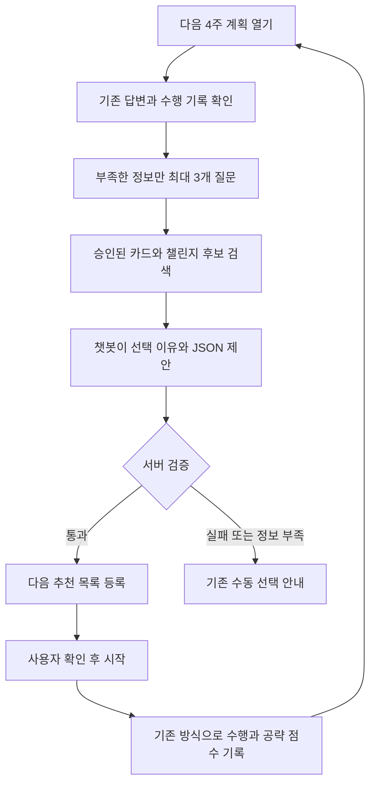

# 당고킬러 RAG 기반 챌린지 추천 기획안

작성: 최병주 · 2026-10-02 · 원본은 노션에 있다. 이 사본은 2026-10-12 에 레포로 옮긴 것이며 내용을 고치지 않았다.

## 1. 기획 배경

현재 챌린지는 팀이 종류와 난이도, 추천 조건을 설정하는 구조다. 사용자마다 기존 습관, 가능한 시간, 장소, 이전 수행 경험이 달라지면서 연계 챌린지의 조합을 모두 조건문으로 관리하기 어려워지고 있다.

RAG 챗봇이 필요한 질문을 하고, 검토된 챌린지 카드에서 적절한 선택지를 찾아 다음 계획을 제안하도록 한다. 팀은 개별 챌린지의 기준을 관리하고, 챗봇은 사용자 상황에 맞는 조합을 맡는다.

**기획 목표는 다음 4주의 생활환경 개선 방향을 제시하는 것이다.** 4주 안의 질환 치료나 위험도 감소를 약속하지 않는다.

## 2. 제안하는 방식과 대안

| 방식 | 장점 | 구현·운영 부담 | 판단 |
| --- | --- | --- | --- |
| RAG + 승인된 챌린지 선택 | 상황에 맞는 질문·설명과 제한된 JSON 출력을 함께 제공 | 카드 정리, 검색, 출력 검증 필요 | 이번 제안의 권장 방식 |
| 고정 설문 + 규칙 추천 | 작은 목록에서는 단순하고 예측 가능 | 상황·예외가 늘면 조건 관리 증가 | 초기 비교 기준 및 실패 시 대체 흐름 |
| LLM이 새 챌린지·수행량까지 생성 | 자유로운 개인화 | 완료 기준·보상·운동량 검토와 등록 범위 확대 | 후속 확장으로 분리 |

첫 버전에서는 새 모델 학습이나 합성 학습데이터가 필요하지 않다. 문서를 검색해 기존 언어모델에 전달하고, 허용된 챌린지 중에서 선택하게 한다. 기존 질환 예측 모델은 별도로 유지한다.

## 3. 핵심 역할

| 구성 | 담당 역할 |
| --- | --- |
| 근거 자료 | 생활습관 안내의 출처와 적용 범위를 제공 |
| 챌린지 카드 | 어떤 상황에서 무엇을 질문하고 어떤 키를 선택할지 연결 |
| 챌린지 기준표 | 키별 허용 난이도, 수행 기준, 완료 판정, 보상, 연계 조건 정의 |
| RAG | 사용자 상황에 맞는 승인된 카드를 검색 |
| 챗봇 | 질문을 표현하고, 답변을 해석하며, 후보와 선택 이유를 제안 |
| 서버 | 키·난이도·근거·선택 자격을 검증하고 기존 등록 기능 호출 |
| 사용자 | 추천을 확인하고 수행할 챌린지를 시작 |

키워드는 자료 수집과 검색을 위한 출발점이다. 실제 추천 품질은 출처를 검토한 카드, 챌린지 기준표, 검색 결과 및 서버 검증에 달려 있다.

## 4. 과제용 MVP 범위

| 항목 | 제안 범위 |
| --- | --- |
| 첫 적용 영역 | 걷기, 좌식 행동 |
| 코퍼스 규모 | 검토된 카드 10\~20개 |
| 질문 수 | 한 계획당 최대 3개, 기존 답변이 있으면 생략 |
| 추천 수 | 계획당 최대 3개, 적합한 후보가 없으면 추천 보류 |
| 난이도 | 팀 기준표에 정의된 단계만 선택 |
| 실행 시점 | 최초 계획 작성 및 다음 4주 계획을 열 때 |
| 등록 | 검증된 후보를 다음 추천 목록에 등록하고 사용자가 시작 |
| 연계 | 다음 주기에서 유지·단계 조정·승인된 대안으로 교체 |

매주 새 계획을 자유 생성하거나 매일 장시간 상담하는 기능은 첫 버전에 포함하지 않는다. 근력, 식생활, 음주, 흡연 영역은 같은 카드 형식으로 확장할 수 있다.

걷기와 좌식 행동을 지원하기 전에 D 파트의 실제 챌린지 목록과 연결 가능한 키를 확인한다. 좌식 행동을 새로운 몬스터로 자동 생성하거나 걷기와 같은 모델 요인으로 합치지 않는다.

## 5. 사용자 흐름



서비스의 '매달 계획'은 이 제안에서 시작일 기준 **4주·28일 주기**로 해석한다. 달력의 매월 1일에 일괄 생성하지 않는다. 첫 버전은 사용자가 다음 계획을 열 때 생성하며, 별도 예약 작업은 필요하지 않다.

4주는 계획을 돌아보는 주기다. 개별 챌린지의 기간은 기존 기준표를 따른다. JSON의 계획 주기를 개별 챌린지 기간에 그대로 덮어쓰지 않는다.

### 질문 예시

1. 이전 경험: "지난 걷기 미션은 쉬웠나요, 적당했나요, 어려웠나요?"
2. 가능한 환경: "다음 4주에는 언제 움직이기 가장 편하세요?"
3. 실천 장벽: "시간, 장소, 몸의 불편함 중 실천을 어렵게 하는 것이 있나요?"

최초 이용자는 첫 질문을 "현재 걷기를 어느 정도 하고 있나요?"로 바꾼다. 걷기 대신 좌식 행동이 후보라면 질문을 해당 영역에 맞게 바꾼다. 기본 답변은 선택형이고 '모르겠어요'와 짧은 자유 입력을 허용한다.

질문 예산 안에서 필수 정보를 얻지 못하면 모르는 값을 추정해 등록하지 않는다. 계획을 보류하거나 기존 수동 선택 화면으로 연결한다.

## 6. 수집할 사용자 정보

| 정보 | 쓰는 목적 |
| --- | --- |
| 이전 수행 기록 | 어떤 챌린지를 경험했는지 확인 |
| 사용자가 느낀 부담 | 유지 또는 단계 조정 후보 선택 |
| 가능한 시간·장소 | 실천할 수 있는 활동 선택 |
| 실천을 막는 이유 | 대안 카드 검색 |
| 선호·거절·해당 없음 | 원하지 않거나 적용할 수 없는 후보 제외 |

미수행만으로 난이도를 올리거나 내리지 않는다. 시간이 없었는지, 수행량이 부담이었는지 사용자 답변을 함께 확인한다. 누락·모름·해당 없음은 '습관이 없다' 또는 숫자 0과 구분한다.

모델 입력 설문의 기준 기간과 챗봇의 질문 기간도 구분한다. 최근 4주 경험과 다음 4주 환경 답변이 기존 건강정보나 최근 1년 습관 응답을 자동으로 덮어쓰지 않도록 한다.

공통 지식 코퍼스에는 개인 대화와 건강기록을 넣지 않는다. 대화에 필요한 정보는 인증된 해당 사용자의 문맥으로만 전달하고, 이름·이메일 등 추천에 불필요한 정보는 제외한다.

## 7. 코퍼스 설계

### 7.1 자료를 카드로 만드는 과정

**키워드 수집 → 공식 자료 선별 → 적용 범위 검토 → 챌린지 카드 작성 → 기준표와 연결 → 승인된 카드 색인**

첫 근거 자료 후보는 WHO 신체활동·좌식 행동 지침이다. 이 지침은 만성질환자를 포함한 집단의 신체활동과 좌식 행동을 다룬다. 현재 확인한 것은 지침 소개 페이지이며, 실제 카드에 넣을 때는 원문 절과 적용 범위를 검토해야 한다. [WHO 지침](https://www.who.int/publications/i/item/9789240015128)

공식 지침이 우리 앱의 난이도 단계나 4주 효과를 직접 검증한 것은 아니다. 카드에는 외부 근거와 팀이 정한 서비스 운영 기준을 구분해 기록한다.

### 7.2 수집 키워드

| 영역 | 검색 키워드 | 우선순위 |
| --- | --- | --- |
| 걷기 | 걷기 습관, 짧은 걷기, 식후 걷기, 출퇴근 걷기, 실내 걷기, 걷기 목표 설정 | MVP |
| 좌식 행동 | 장시간 앉기, 좌식 시간 중단, 사무직 활동, 활동 휴식, 앉아서 일하는 생활 | MVP |
| 실천 유지 | 작은 목표, 행동 계획, 자기 기록, 실천 장벽, 목표 재조정, 대체 행동 | MVP 공통 |
| 근력 활동 | 초보 근력 운동, 맨몸 운동, 의자 운동, 운동 단계 조절, 운동 지속 | 후속 |
| 식생활 | 외식 습관, 배달 음식, 식사 규칙성, 식품 표시 읽기, 식사 기록 | 후속 |
| 나트륨 관리 | 국물 섭취, 소스 사용, 가공식품, 저염 선택, 외식 메뉴 선택 | 후속·추천 정책 별도 확인 |
| 음주 | 음주 빈도, 음주 상황, 음주 기록, 모임 대처, 대체 음료 | 후속 |
| 흡연 | 흡연 유발 상황, 금연 준비, 흡연 욕구 대처, 금연 지원 | 후속 |

### 7.3 사용자 표현과 검색 태그

| 사용자 표현 | 검색 태그 |
| --- | --- |
| "회사에서 계속 앉아 있고 운동할 시간이 없어요." | 사무직, 좌식 행동, 시간 부족 |
| "비가 오면 걷기 미션을 못 해요." | 걷기, 날씨, 실내 대안 |
| "지난 미션은 시간이 너무 길었어요." | 수행 부담, 짧은 활동, 난이도 조정 |
| "회사 식당에서 먹어서 메뉴 선택이 어려워요." | 식사 선택권, 직장 식사, 제한된 환경 |
| "회식 때문에 지키기 어려웠어요." | 사회적 상황, 모임, 실천 장벽 |

마지막 두 예시는 후속 영역의 검색 설계 예시다. MVP에서 식생활·음주 추천까지 활성화한다는 뜻은 아니다.

### 7.4 카드 구성

| 항목 | 기록할 내용 |
| --- | --- |
| 카드 ID·버전 | 검색 결과와 추천 근거를 추적하는 식별자 |
| 주제·태그 | 행동 영역, 시간·장소·장벽 등 상황 |
| 근거 | 자료 제목, URL, 원문 위치, 발행일·검토일, 적용 대상 |
| 안내 요약 | 근거 범위 안에서 설명할 수 있는 내용 |
| 확인 질문 | 선택에 필요한 정보와 답변 항목 |
| 연결 키 | 현재 승인된 챌린지 키 |
| 선택 기준 | 어떤 답변이면 해당 키·단계를 후보로 넣는지 |
| 대체·연계 | 기준표에서 허용한 대안 또는 다음 단계 |
| 제외 조건 | 추천을 보류하거나 다른 후보를 찾는 조건 |
| 승인 상태 | 초안, 승인, 비활성 |

한 카드가 하나의 실천 상황을 다루도록 한다. 자료를 글자 수만으로 잘라 출처·대상·제외 조건을 떨어뜨리지 않는다. 수행량·완료 기준·보상은 카드에 중복 정의하지 않고 챌린지 기준표를 참조한다.

## 8. 질문과 연계 챌린지 선택 원칙

챗봇은 이전 수행 경험과 현재 환경을 함께 보고 유지·단계 조정·교체 후보를 제안한다.

| 확인된 상황 | 후보 선택 방향 |
| --- | --- |
| 부담이 적당하고 환경도 유지됨 | 같은 키·단계 유지 |
| 쉽다고 답하고 승인된 다음 단계 조건도 충족 | 다음 단계 제안, 사용자 선택 |
| 수행량이 부담이었다고 답함 | 허용된 낮은 단계 검토 |
| 시간·장소가 바뀜 | 같은 목적의 승인된 대안 검토 |
| 수행 기록만 있고 이유를 모름 | 이유를 질문한 뒤 선택 |
| 해당 없음·거절·선택 제한 상태 | 기존 제외 정책 적용 |
| 활동 시 불편함 등 검토가 필요한 답변 | 해당 활동의 단계 상향을 보류하고 정해진 안내 제공 |

연계 가능한 키와 선행 조건은 기준표에서 관리한다. 챗봇이 임의로 새 연결을 만들지 않는다. 모든 사용자 조합을 열거할 필요는 없지만, 챌린지마다 허용된 단계·대안·선행 조건은 남아 있어야 한다.

## 9. JSON 출력 제안

다음은 **신규 내부 출력 형식의 예시**다. 키와 카드 ID는 설명용이며, 현재 DB에 존재하거나 실행 가능한 값으로 확인된 것이 아니다.

```json
{
  "schema_version": "1.0",
  "cycle_weeks": 4,
  "challenges": [
    {
      "challenge_key": "WALK_AFTER_LUNCH",
      "difficulty_value": 1,
      "evidence_card_ids": ["WALK_TIME_BARRIER_01"],
      "reason": "점심시간에 실천할 수 있고 짧은 활동을 선호한다고 답했어요."
    },
    {
      "challenge_key": "BREAK_LONG_SITTING",
      "difficulty_value": 2,
      "evidence_card_ids": ["SITTING_OFFICE_01"],
      "reason": "업무 중 잠깐 자리에서 움직일 수 있다고 답했어요."
    }
  ]
}
```

실행에 쓰는 핵심 값은 `challenge_key`와 `difficulty_value`다. `reason`은 사용자 설명용이고, `evidence_card_ids`는 검색한 카드와 선택 이유를 검토하기 위한 값이다.

난이도 1·2·3은 팀이 해당 키에 정의한 단계에 연결하는 제안이다. 모든 키가 세 단계를 가져야 하는 것은 아니다. 시간·횟수·강도·보상은 서버가 기준표에서 조회하며 챗봇이 생성하지 않는다.

구조화 출력을 지원하는 모델을 사용해 필수 필드와 자료형을 제한한다. OpenAI를 선택한다면 Structured Outputs가 적용 후보다. 다만 구조화된 출력에도 내용 오류가 있을 수 있으므로 업무 규칙은 서버가 검증한다. [OpenAI 공식 문서](https://developers.openai.com/api/docs/guides/structured-outputs)

## 10. 서버 검증과 자동 등록

### 필수 검증

- 필수 필드·자료형·지원 버전이 맞는가?
- 추천은 최대 3개이고 키가 중복되지 않는가?
- 해당 키가 현재 활성화되어 있고 사용자에게 선택 가능한가?
- 해당 키에 존재하는 난이도인가?
- 근거 카드가 이번 검색에서 전달된 승인 버전이며 해당 키·단계를 뒷받침하는가?
- 기존 선행 조건, 중복 수행, 거절·해당 없음·추천 제한 정책을 만족하는가?
- 설명이 실제 답변 및 카드와 맞고, 질환 치료나 위험도 감소를 단정하지 않는가?

마지막 설명의 적절성은 구조 검사만으로 보장할 수 없다. 제한된 설명 형식과 사전 사례 검토를 함께 사용한다. 검증 실패, 근거 부족, 모델 응답 실패 시 추천을 자동 등록하지 않고 기존 수동 선택을 제공한다.

통과한 JSON은 **추천 목록**에 등록한다. 사용자가 시작을 선택하면 D 파트의 기존 시작 기능을 호출한다. 챗봇은 DB에 직접 쓰거나 사용자가 시작하지 않은 챌린지를 활성 상태로 만들지 않는다.

같은 사용자·계획 주기에서 재시도해도 중복 추천이 생기지 않도록 한다. 진행 중인 챌린지는 기존 중단 흐름 없이 교체하지 않는다. 추천 결과에는 사용한 기준표·카드 버전을 추적할 수 있게 한다.

## 11. 기존 설계와의 연결

### 건강 정보와 게임 값

| 값 | 이 기능의 관계 |
| --- | --- |
| 위험도 | 기존 모델과 재예측 경로 유지. RAG 답변으로 변경하지 않음 |
| 위협도 | 기존 산출 경로 유지. 챌린지 추천으로 변경하지 않음 |
| 공략 점수 | 기존 챌린지 수행 처리에서 기록. 챗봇이 보상량을 정하지 않음 |

수행하지 못한 날의 감점이나 연속 기록 초기화를 추가하지 않는다. 기존 기준표와 보상·점수 정책을 참조하며 별도 계산 규칙을 복제하지 않는다.

### 데이터와 소유 경계

- 챌린지·추천·수행 처리는 D가 제공하는 기능을 통해 연결한다.
- 경험치·레벨 처리는 기존 A의 내부 함수를 따른다.
- 건강정보 조회·저장과 예측은 각각 C·B의 기존 경로를 따른다.
- API, 추천 출처, 저장 항목, 오류 코드가 추가되면 공식 시트와 팀 계약을 먼저 갱신한다.

이전 대화에서 확인한 2026-10-01 팀 논의는 추천 출처를 `prediction_personal`·`diagnosis_global` 중심으로 다뤘다. 대화 기반 추천을 어느 출처로 저장할지는 구현 전 최신 명세를 확인하고 A·D가 합의해야 한다. 기존 예측 출처로 잘못 기록하지 않는다.

저장 계약이 확정되기 전 데모는 검증된 후보를 화면에 제시하고 기존 수동 시작 경로를 사용한다. 이 경우 '추천 목록 자동 저장 완료'로 발표하지 않는다. 이후 계약이 확정되면 자동 저장을 연결한다.

자료 수집과 추천 허용은 별개다. 팀이 추천 적용을 보류한 영역은 RAG에 자료가 있어도 자동 추천을 활성화하지 않는다.

## 12. 최소 기술 구성

1. 검토된 카드 파일과 D의 챌린지 기준표를 준비한다.
2. 카드의 안내·질문·상황 표현을 임베딩해 작은 검색 색인을 만든다.
3. 승인 상태·행동 영역·허용 키를 필터링한 뒤 관련 카드 최대 3개를 검색한다.
4. 해당 카드와 사용자 답변, 허용 키·난이도를 모델에 전달한다.
5. 모델은 질문 또는 최종 추천 JSON을 반환한다.
6. 서버가 검증하고 D의 추천·시작 흐름으로 연결한다.

첫 버전은 단일 검색 색인과 단일 모델 호출 흐름으로 구성한다. 별도 벡터 DB 서버나 여러 에이전트를 필수로 두지 않는다. 질환 추론·SHAP은 기존 `ai_worker` 경로를 유지하고, RAG 응답의 대기·실패 처리는 별도로 정한다.

## 13. 검증과 완료 기준

먼저 가상 사용자 사례 20개를 만들고 기대하는 카드, 허용 키·단계, 보류 조건을 수작업으로 정한다. 가상 사례는 기능 검증 자료이며 실제 사용자 효과나 건강 개선을 증명하지 않는다.

| 검증 영역 | 확인 방법 | MVP 제안 기준 |
| --- | --- | --- |
| 검색 | 예상한 카드가 상위 3개에 있는지 | 추천 가능 사례의 90% 이상 |
| 선택·설명 | 답변·카드와 추천이 일치하는지 수작업 검토 | 어긋난 사례는 수정 후 다시 확인 |
| 등록 검증 | 알 수 없는 키, 금지 단계, 비활성 카드, 제한 사용자를 넣어 확인 | 잘못된 후보 자동 등록 0건 |
| 대화 | 처음 이용·시간 부족·환경 변화·모름·해당 없음 사례 | 질문 최대 3개, 모르는 값 추정 등록 0건 |
| 연계 | 유지·상향·하향·대안·진행 중 중복 사례 | 기준표의 선행·제외 조건 준수 |
| 실패 처리 | 검색 근거 부족·응답 실패·잘못된 JSON | 수동 선택 가능, 중복 등록 0건 |

위 수치는 출시 성능이 아닌 과제용 제안 목표다. 실제 평가 전 달성했다고 표시하지 않는다. 같은 사례에 고정 설문·규칙 추천을 적용해 비교하고, RAG가 질문·설명·환경 대응에 어떤 차이를 만드는지도 확인한다.

## 14. 작업 분담과 진행 순서 제안

공통 계약은 한 담당자가 정리하고, 계약이 맞춰진 뒤 모듈 구현을 병렬로 진행한다. 아래는 기존 파트 경계를 따른 제안이며 확정된 추가 업무 배정은 아니다.

| 구간 | 주관 제안 | 산출물 |
| --- | --- | --- |
| 공통 계약 정리 | A 총괄, D와 C 검토 | 출력·저장·시작 연결 방식, 필요한 시트 변경 |
| 챌린지 기준 연결 | D | 승인 키·단계·대안·선행 조건·검증 항목 |
| 코퍼스·RAG | 담당 1명 지정, B가 모델 입력 경계 검토 | 승인 카드, 검색, JSON 생성, 사례 검토 |
| 대화·추천 화면 | C | 질문, 추천 이유, 시작, 실패 시 수동 선택 |
| 통합 확인 | A·D 중심 | 중복·제외 정책·보상 경계와 전체 흐름 확인 |

진행 순서는 **지원 키 확정 → 카드 10\~20개 작성 → 20개 사례 기준 작성 → 검색·질문·JSON 연결 → 검증·추천 등록 연결 → 화면 확인**으로 잡는다.

## 15. 팀 검토 시 결정할 항목

- 걷기·좌식 행동에 실제 연결할 키와 난이도 목록.
- 승인 카드 작성·검토 담당자.
- 대화 기반 추천의 출처와 최소 저장 항목.
- 첫 데모가 화면 제안까지인지, 추천 목록 저장까지인지.
- 4주 계획과 기존 개별 챌린지 기간의 연결 방식.

### 기획 요약

**사용자의 상황은 짧은 대화로 확인하고, RAG는 검토된 실천 근거를 찾으며, 챗봇은 승인된 챌린지 키와 난이도를 제안한다. 서버 검증을 통과한 후보를 다음 추천 목록에 등록하고 사용자가 시작한다.**

모든 조합을 조건문으로 관리하는 부담을 줄이되, 수행 기준·보상·건강 정보의 의미는 기존 설계에서 일관되게 유지한다.
